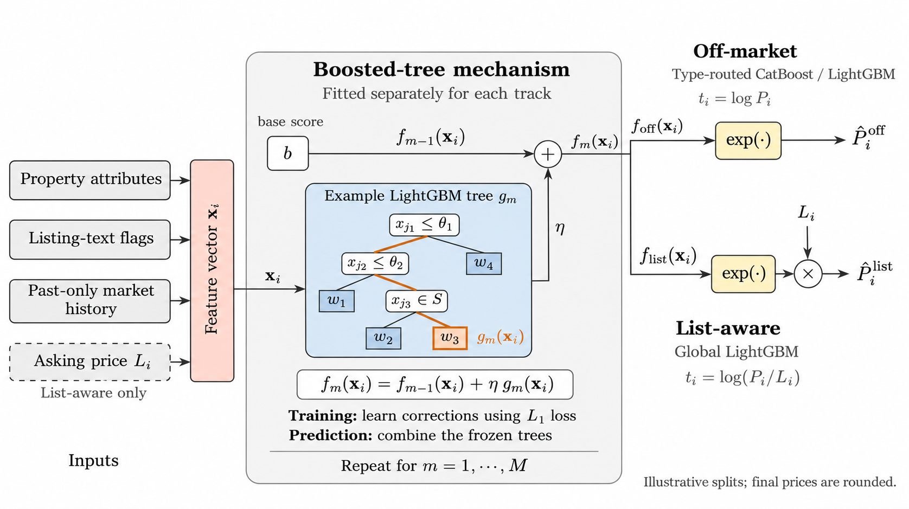
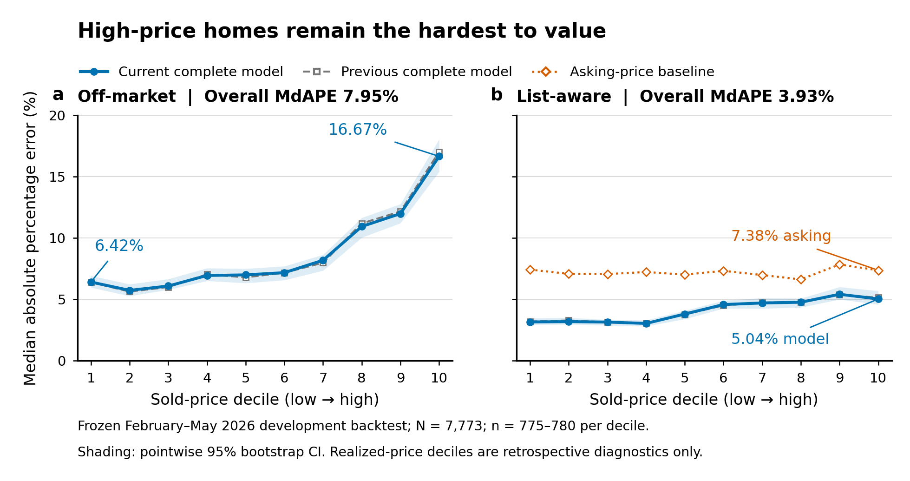

# SSU Data Dash 2026: Toronto Home-Price Prediction

**Draft v18 | November 8, 2026**

**Team name:** hmf  
**Team member:** Frank hu  
**YouTube video:** [https://youtu.be/_39kVEx1bFA](https://youtu.be/_39kVEx1bFA)  
**Team code and submission GitHub repository:** [hmengfan693/SSU-Data-Dash-2026](https://github.com/hmengfan693/SSU-Data-Dash-2026)

## Summary

We predict synthetic Toronto home sale prices for initial seller valuation (Off-market) and listed-home assessment (List-aware), using boosted trees with property attributes and strictly past market summaries; List-aware also learns an asking-price adjustment. Under the **official-protocol monthly walk-forward validation** for December 2025-May 2026, selected-model MdAPE is **7.62% Off-market** and **3.93% List-aware**, on **10,069 homes per track**, with refitting before each month. Under **our fixed-four-month validation** for February-May 2026, MdAPE is **7.95%** and **3.93%**, on **7,773 homes per track**, with models and historical pools frozen before February. These are two evaluations of the same selected specifications under different samples and updating rules. Both are cumulative development results; configuration selection overlapped December 2025, and hidden-test accuracy is unknown.

## 1. Data and features

The official data contain 150,000 synthetic sales from January 2021 through May 2026. Hidden June-September sets contain 3,974 Off-market and 4,064 List-aware homes, with different IDs. We use Parquet without duplicating its CSV equivalent. No outside prediction data are used.

**Property information.** Inputs cover type, style, location, rooms, parking, garage, floor area, lot dimensions and listing date. Area ranges retain bounds, midpoint and a range flag. Frontage times depth is a rectangular lot proxy with missingness. The base representation has 31 property/calendar/lexical inputs and 33 historical statistics; enhanced branches add historical reliability, lot context and detailed condition flags.

**Listing text.** Predefined word and phrase rules convert `remarks` into binary indicators for renovation, maintenance, work required, readiness, basement/entrance features and views. Enhanced Detached, Semi-Detached and List-aware inputs normalize case/contractions, split clauses and screen negated or proposed improvements: "not renovated" does not count as renovation. Co-Op retains earlier enrichment rules. Multiple conditions can coexist; these are textual cues, not verified measurements.

**Historical windows.** Market, type and community-type groups use the preceding 90, 180 and 365 days; coordinate-type groups use 365 days. Counts and smoothed means of log price and log price per square foot summarize permitted history, with sparse groups borrowing broader-group statistics. These feature lookbacks are distinct from the expanding multi-year training sample, the one-month official validation horizon, and the four-month final forecast.

**Availability.** Off-market excludes asking price. List-aware adds asking-price levels, unit prices, deviations from historical community prices and past sold/list ratios. Sale price is the target; sale date controls eligibility and scoring. IDs, final days on market and external AVM fields are excluded from prediction features.

## 2. Models

**How boosted trees work.** Training pairs past-only features with transformed targets. Each tree learns conditional rules and supplies a leaf contribution (Figure 1); successive trees learn loss-based corrections. The fixed ensemble combines them as $f(X)=b+\eta\sum_m g_m(X)$, with base score $b$ and learning rate $\eta$. Prediction applies these trees without per-home retraining.

**Why LightGBM.** We chose LightGBM because our tabular inputs mix numeric and categorical variables, and location, size and property type interact nonlinearly. Histogram-based split search supports efficient fitting; leaf limits, minimum leaf sizes and penalties let us constrain complexity.

**Off-market.** Without asking price, we learn $t_i=\log P_i$ and predict $\operatorname{round}\{\exp(f(X_i))\}$. Condo Apt and Co-Op use shared-apartment CatBoost, with 59 and 73 inputs. LightGBM handles Condo Townhouse using own-type sales (59 inputs); Detached and Freehold Townhouse pool all freehold types (112/64); Semi-Detached shares with Freehold Townhouse (112). Type determines routing. Separate routes accommodate different price relationships; pooling supplies related training examples.

**List-aware.** One global LightGBM uses all six types and 150 inputs, including type, property/text attributes, past-market features, asking-price levels, local-price deviations and historical sold/list ratios. It learns $t_i=\log(P_i/L_i)$ and predicts $\operatorname{round}\{L_i\exp(f(X_i))\}$. Asking price $L_i$ supplies each home's scale; trees learn its relative correction. A global model shares information while allowing type interactions. Past ratio features use smoothed log means, counts and recency over 90/180/365 days. Positive scores imply above-asking predictions.

**Loss and fitting.** Both minimize $\mathcal L=N^{-1}\sum_i|f(X_i)-t_i|$. Small log errors approximate relative errors; L1 gives extreme log residuals less influence than squared loss. This is a surrogate, not direct MdAPE optimization; no loss ablation establishes optimality. Category vocabularies and fitting use training data only. Frozen settings include 680 trees/21 maximum leaves for List-aware; evaluation-label early stopping is excluded (Appendix A).

**Interpretability.** Gain emphasizes location and past prices/ratios. Appendix C reconstructs one prediction from additive contributions. These describe fitted behaviour, not causal effects; correlated inputs share credit. Asking price also multiplies List-aware output outside the trees.

{width=16.6cm height=9.3cm}

*Figure 1. Boosted-tree mechanism fitted separately for each track. Orange marks an illustrative path; final prices are rounded.*

## 3. Validation and final prediction

**Official monthly validation.** Following the [official schedule](https://github.com/erwinzhang7/SSU-Data-Dash/blob/main/run.py), predict December 2025-May 2026 one month at a time: train on all sales before each month's first day, then refit weights and training-only category vocabularies. The training span expands from 2021. Reference pools refresh between months and freeze within each month; feature definitions, parameters and type routes remain fixed. There are 10,069 homes per track.

**Our fixed-four-month validation.** To mirror the final forecast's update-free horizon, fit 142,227 sales before February 1 and predict all 7,773 February-May homes together. Models, category vocabularies and reference pools stay frozen throughout. Earlier development windows cover January-April, May-August and September-December 2025.

**Label boundaries.** Training sales precede cutoff $C$; historical price queries use $[q_i-W,q_i)$, where $q_i=\min(\text{listing date}_i,C)$, excluding future, same-day and self-sale labels. Monthly folds never fit current-month outcomes; completed-month sales may enter the next fold. Sale-month eligibility does not mean retraining at each listing date. Existing configuration selection covered September-December 2025 and overlaps the first official fold; prior decisions also reused development outcomes. These are cumulative development results, not untouched tests.

**Final forecast.** Refit each designated population within all 150,000 known sales through May, retain the same specifications and rebuild history at June 1. Predict June-September without summer labels: 3,974 Off-market and 4,064 List-aware rows, with checked IDs, columns and positive finite prices. Validation errors come from the earlier evaluation models, not these final refits.

## 4. Results

The Model column marks each protocol; Homes gives its evaluation sample. MdAPE is median individual absolute percentage error; MAPE is its mean. Lower is better.

| Track | Model | Homes | MdAPE, % [95% interval] | MAPE, % |
| --- | --- | --- | --- | --- |
| Off-market | Selected property-type trees (official monthly validation) | 10,069 | 7.62 [7.45, 7.81] | 10.19 |
| List-aware | Asking-price baseline (official monthly validation) | 10,069 | 7.26 [7.12, 7.41] | 8.09 |
| List-aware | Selected global ratio model (official monthly validation) | 10,069 | 3.93 [3.83, 4.04] | 5.04 |
| Off-market | Selected property-type trees (team's fixed-four-month validation) | 7,773 | 7.95 [7.72, 8.19] | 10.38 |
| List-aware | Asking-price baseline (team's fixed-four-month validation) | 7,773 | 7.20 [7.05, 7.37] | 8.03 |
| List-aware | Selected global ratio model (team's fixed-four-month validation) | 7,773 | 3.93 [3.83, 4.07] | 5.19 |

The asking-price baseline predicts the listed price directly. Brackets are 95% home-bootstrap intervals: official monthly rows use 1,000 resamples (seed 0); fixed-four-month rows retain 2,000 (seed 20261104). Each overall score pools individual-home errors, without averaging subgroup medians. Intervals omit temporal dependence and selection reuse.

Both protocols evaluate the same current-best specifications. Their different samples, cutoffs and updating prevent direct ranking across protocols; compare baselines within each protocol. Appendix F retains preceding-model comparisons; G gives monthly detail and a matched-sample protocol comparison. Hidden-test accuracy is unknown.

## 5. Supplementary fixed-four-month error analysis

The following diagnostics and Figure 2 correspond to the team's fixed-four-month rows in Section 4: 7,773 February-May homes predicted with a January-end frozen information set. They examine failure under the final forecast's longer, update-free horizon; the official monthly diagnostics remain separately identified in Appendix G.

**High prices.** In the highest-price decile (778 homes; Figure 2), Off-market MdAPE is **16.67%**, versus 6.42% in the lowest, with median signed error **-13.84%**. List-aware is 5.04%, versus asking price 7.38% and previous ratio 5.15%. Central shrinkage or missing quality information may contribute, but outcome-defined groups alone cannot establish the cause or route future predictions.

**Type and size.** Co-Op has only 41 homes: Off-market MdAPE/MAPE is 11.90%/21.07%, revealing a long tail. Area-midpoint groups at least 2,000 versus below 1,000 sq ft have MdAPE 12.04%/6.15% (1,290/3,073 homes). Overall gains hide townhouse regressions of 0.29/0.34 points Off-market; List-aware Co-Op/Semi-Detached also worsen against their preceding complete model (Appendix E).

**Location and time.** Across 12 communities with at least 100 homes, Off-market MdAPE ranges from 6.03% in Cedarview (154) to 10.02% in Elmview (139; previous model 10.00%). February-May MdAPE is 7.80%, 7.44%, 7.96% and 8.37%. Property mix confounds location, size and month comparisons. Overall, 12.21% Off-market and 1.53% List-aware predictions exceed 20% error; expensive, unusual and weakly supported homes warrant manual review. Full comparisons remain in Appendix E.

{width=16.6cm}

*Figure 2. Supplementary fixed-four-month forecast: MdAPE by realized-price decile, 7,773 February-May homes. Shading: pointwise 95% row-bootstrap intervals (2,000 resamples per decile); these omit temporal dependence and selection bias.*

## 6. Limitations and next steps

Synthetic geography cannot support real amenity joins; area/lot proxies and text flags are imperfect. Asking-price relationships can shift. The official-protocol monthly evaluation is complete, but configuration selection overlapped December 2025; its scores and row-bootstrap intervals do not remove development reuse or establish performance under future regimes. Next, test on an unused period, examine within-type size/location effects and calibrate past-only prediction intervals. Keep existing specifications frozen until an earlier-period comparison supports a change.

## Outside data

| Source | URL | Periods covered |
|---|---|---|
| None | No outside prediction data used | Not applicable |

The [official competition dataset](https://huggingface.co/datasets/Baliyang/SSU_data_dash), [starter code](https://github.com/erwinzhang7/SSU-Data-Dash) and [report template](https://github.com/erwinzhang7/SSU-Data-Dash/blob/main/report/report.tex) are competition materials. The official starter repository is not a substitute for the team's own code-and-submission link above.

## Appendix A. Frozen settings and reproduction

| Model / branch | Trees | Max leaves | Rate | Min leaf | L1 | L2 | Feature fraction |
| --- | --- | --- | --- | --- | --- | --- | --- |
| Detached | 830 | 11 | 0.08206 | 26 | 0.00000 | 1.48059 | 0.97944 |
| Semi-Detached | 867 | 59 | 0.05369 | 47 | 0.19356 | 2.79978 | 0.94503 |
| Freehold Townhouse | 386 | 18 | 0.14491 | 35 | 0.63152 | 30.00000 | 1.00000 |
| Condo Townhouse | 359 | 15 | 0.05579 | 40 | 0.92977 | 4.56920 | 1.00000 |
| List-aware global | 680 | 21 | 0.04208 | 31 | 0.72138 | 2.86753 | 1.00000 |

Rate is the learning rate; minimum leaf is the minimum training sample count in a leaf. L1/L2 penalize leaf weights; feature fraction is the per-tree feature sampling fraction. Displayed decimals are rounded; saved schemas retain exact values.

### Official-protocol monthly validation

From the local team release directory `output/github/SSU-Data-Dash-2026/`, use Python 3.11 and its pinned `requirements.txt`:

```sh
python run.py validate --data-dir /path/to/data --output /new/validation/folder
python verify_official_validation.py --data-dir /path/to/data --output /new/validation/folder
```

The input folder contains the official observed listings; the output folder must be new. Validation rebuilds features and fits all seven selected branches in each of six months, then writes the models, training IDs, fold audits, predictions and scores. The independent verifier checks cutoffs, sample coverage, training populations, frozen parameters and pooled metrics. All February predictions exactly reproduce the indexed development models at their identical February 1 cutoff. The local completed run is archived at `output/validation/official_monthly_2026-11-08/`. Its compact evidence is copied to this draft's `evidence/official_monthly/`.

### Archived final-forecast replay in the research repository

Use Python 3.11 in the complete research repository, with the official three Parquet files in `../data`. Place this report folder at `report_draft/` under the repository root. Keep model schemas, the archives selected by `CURRENT_BEST_MODEL.json`, preceding feature code and the inherited apartment predictions. Off-market replay reloads four saved LightGBM branches and retains frozen apartment outputs from the preceding complete pipeline.

```sh
python -m pip install -r experiments/plan_a/requirements.txt
export OMP_NUM_THREADS=1
export OPENBLAS_NUM_THREADS=1
export MKL_NUM_THREADS=1

python report_draft/source/reproduce_predictions.py \
  --repo . --data-dir ../data \
  --output reproduced_submission
```

Use a new output directory. The entry point reads the repository index, reproduces both files, verifies their hashes and checks IDs, columns and positive finite prices. The source package does not include the large model or data archives. The original `run.py predict` invokes starter models and does not reproduce these selected pipelines.

## Appendix B. Artifact record and draft completion

| Track | Rows | Replay output | SHA-256 |
| --- | --- | --- | --- |
| off_market | 3,974 | `submission_off_market.csv` | `be936afb011f4f4a142d71d589b6481328592de496da5445c04068f8860d15db` |
| list_aware | 4,064 | `submission_list_aware.csv` | `31ec87891f76043921da5ad1f4af7e8e7c4476a83459568398b9f38ace3dc4e8` |

Exact source locations are resolved from the `final_predictions` field of the corresponding track in `CURRENT_BEST_MODEL.json`. Reproduction in preparing this draft regenerated both selected forecasts and matched their archived bytes. This establishes artifact consistency, not hidden-test accuracy.

In the research repository, the existing top-level `submissions/` files remain starter-baseline outputs. The November 4 submission package is an older archive whose List-aware file predates this report's current selection. The separate local team release at `output/github/SSU-Data-Dash-2026/` matches the indexed final forecasts and now also contains the monthly validation entry point. Before submission, verify the latest accessible team repository, run the official checker there, and verify the identity and video links. Updating this draft does not establish external synchronization or organizer submission.

Team name and member name are supplied above, together with the GitHub and YouTube links. The video metadata reports a duration of 4 minutes 31 seconds; the link returned playable status when checked. The latest external release and form submission still require confirmation. Official-protocol monthly validation is complete (Appendix G). The report body is laid out in four pages, with the outside-data table and appendices following separately under the official template's page-count convention. Verify the team member name and video playback before submission.

## Appendix C. Model interpretability

### Global importance

| Selected final model | Largest split-gain share | Second | Third |
| --- | --- | --- | --- |
| Off-market: Detached | Community (26.2%) | Community-type 365-day log price (16.3%) | Washrooms (10.7%) |
| Off-market: Semi-Detached | Community (27.3%) | Floor-area lower bound (3.4%) | Washrooms (3.2%) |
| Off-market: Freehold Townhouse | Community (26.7%) | Community-type 365-day log price (17.4%) | Washrooms (10.7%) |
| Off-market: Condo Townhouse | Community (27.1%) | Coordinate group (26.9%) | Floor-area lower bound (11.3%) |
| List-aware global | Coordinate group (34.4%) | Community-type 90-day mean log sold/list ratio (14.0%) | Community (13.1%) |

Percentages are shares of split gain within each final LightGBM model, fitted on permitted data through May. They are not shares of price or accuracy, nor held-out causal importance. Raw gains across different targets and training populations are not pooled; CatBoost uses a different importance definition and is not mixed into this table.

Location and past local context are prominent. Correlated location encodings can share or exchange credit, and gain alone does not identify effect direction. Asking price also multiplies the entire List-aware output, so its structural role is not captured by its direct tree-feature importance alone. Property type similarly controls Off-market routing even if constant inside a branch.

### Local decomposition of one prediction

The ID-selected example `SYN-0000026` is the lexicographically first Detached home in the February-May cohort, chosen without examining errors. It has a 1500-1699 sq ft area range, three washrooms and asking price $1,688,200. Its historical features were rebuilt using the January-cutoff evaluation models; these are distinct from the May-fitted models used for global importance.

LightGBM's built-in feature contributions satisfy $f(X)=\phi_0+\sum_j\phi_j$. Here $\phi_0$ is the explanation's model expected-value term; it is not generally the initial training score $b$ in the boosting formula.

| Contribution group | Off-market: log price | List-aware: log sold/list |
| --- | --- | --- |
| Location | -0.0815 | +0.0116 |
| Historical sale prices | -0.0923 | -0.0026 |
| History reliability | +0.0002 | +0.0001 |
| Lot and land context | +0.0118 | +0.0005 |
| Description flags | +0.0230 | +0.0021 |
| Other property attributes | -0.0229 | +0.0114 |
| Listing calendar | -0.0009 | -0.0043 |
| Asking-price features | — | -0.0737 |
| Sold-to-list history | — | -0.0240 |
| Total feature contribution | -0.1627 | -0.0791 |
| Expected-value term | +14.1492 | -0.0077 |

Values are rounded log contributions. Dashes indicate inputs unavailable to that track. Signs describe the model output relative to its own expected-value term, not causal changes to an otherwise identical real home. Contributions add in log space; converting to price requires exponentiation and, for List-aware, multiplication by asking price.

Full-precision reconstruction gives **$1,186,505 Off-market** and **$1,547,898 List-aware**, exactly matching the selected archived predictions. In this example, price history and location lower the Off-market estimate; asking-price features and sold-to-list history lower the List-aware adjustment. A single case does not establish representative accuracy or general causal effects.

Method reference: [LightGBM Booster documentation](https://lightgbm.readthedocs.io/en/stable/pythonapi/lightgbm.Booster.html), gain importance and `pred_contrib=True`.

## Appendix D. Evidence files

| File | Purpose |
|---|---|
| `evidence/report_evidence.json` | Recomputed metrics, paired intervals and forecast hashes |
| `evidence/official_monthly/official_metrics.json` | Primary official-protocol monthly scores and 1,000-resample intervals |
| `evidence/official_monthly/asking_price_metrics.json` | Asking-price baseline on the identical 10,069 homes under the same scoring convention |
| `evidence/official_monthly/validation_predictions.csv` | All scored home predictions from the six monthly folds |
| `evidence/official_monthly/comparison_fixed_vs_monthly.csv` | Matched February-May IDs; differences between updating protocols, not a model ranking |
| `evidence/official_monthly/verification_summary.json` | Completed 42-model run, independent audit and original-artifact preservation record |
| `evidence/slice_metrics.csv` | Aligned monthly, type and price-decile comparisons |
| `evidence/failure_slice_metrics.csv` | Community, size, signed errors and full tail comparisons |
| `source/failure_diagnostics.py` | Recompute added diagnostics without fitting |
| `evidence/final_lgbm_importance.csv` | Feature gains and within-model normalized ranks |
| `evidence/interpretability.json` | Local example selection, model hashes and reconstruction checks |
| `evidence/local_group_contributions.csv` | Full-precision grouped log contributions |
| `evidence/replay_checks.json` | Exact forecast replay and official-format checks |
| `source/prepare_evidence.py` | Recompute tables and intervals without fitting |
| `source/explain_models.py` | Rebuild example features and replay contribution calculations |
| `source/reproduce_predictions.py` | Reproduce the selected forecast files from the repository index |


## Appendix E. Detailed fixed-four-month error diagnostics

All diagnostic tables in this appendix use the same 7,773-home frozen February-May forecast. Official-protocol monthly scores are reported separately in Section 4 and Appendix G.

### Property types

| Type | Homes | Off-market MdAPE, % | Off-market ref. - best, pp | List-aware MdAPE, % | Asking price - best, pp | Previous ratio - best, pp |
| --- | --- | --- | --- | --- | --- | --- |
| Condo Apt | 3,615 | 6.49 | 0.00 | 3.12 | +3.96 | +0.018 |
| Condo Townhouse | 472 | 6.60 | -0.29 | 3.88 | +2.83 | +0.023 |
| Detached | 2,482 | 10.28 | +0.04 | 4.99 | +2.63 | +0.017 |
| Semi-Detached | 847 | 10.84 | +0.36 | 5.43 | +1.11 | -0.047 |
| Freehold Townhouse | 316 | 9.50 | -0.34 | 5.55 | +2.03 | +0.005 |
| Co-Op Apt | 41 | 11.90 | 0.00 | 5.48 | +4.55 | -0.056 |

References are the previous enhanced Off-market pipeline, asking price and the previous ratio model. Positive gaps favour the current best; negative gaps disclose deterioration. All comparisons use identical homes and fixed prediction boundaries.

### Months and price deciles

| Sale month | Homes | Off-market MdAPE, % | Off-market ref. - best, pp | List-aware MdAPE, % | Asking price - best, pp |
| --- | --- | --- | --- | --- | --- |
| 2026-02 | 1,442 | 7.80 | +0.08 | 3.92 | +3.24 |
| 2026-03 | 1,816 | 7.44 | 0.00 | 3.85 | +3.24 |
| 2026-04 | 2,224 | 7.96 | +0.12 | 3.93 | +3.31 |
| 2026-05 | 2,291 | 8.37 | +0.08 | 4.04 | +3.21 |

These are slices of the same fixed February-May forecast, with no monthly refits. Positive reference-minus-best gaps favour the current best. The reference is the previous enhanced Off-market pipeline or asking price, as labelled. March Off-market is worse by 0.004 points before rounding.

| Actual-price decile | Homes | Off-market MdAPE, % | Off-market ref. - best, pp | List-aware MdAPE, % | Asking price - best, pp |
| --- | --- | --- | --- | --- | --- |
| 1 | 780 | 6.42 | -0.01 | 3.16 | +4.27 |
| 5 | 778 | 7.00 | -0.20 | 3.81 | +3.22 |
| 10 | 778 | 16.67 | +0.36 | 5.04 | +2.34 |

Price deciles use realized sale price for retrospective diagnostics only. Full within-type, monthly and decile comparisons, including the previous ratio model, are retained in `evidence/slice_metrics.csv`.

The official starter's separate monthly evaluation uses December 2025-May 2026, 10,069 homes per track, refitting each month: nearest-neighbour MdAPE/MAPE is 20.84%/27.43%, while asking price is 7.26%/8.09%. The selected specifications have now also completed that monthly schedule: MdAPE/MAPE is 7.62%/10.19% Off-market and 3.93%/5.04% List-aware. None of these monthly figures should be subtracted from the fixed-horizon tables as a same-protocol model comparison.

Method details: [LightGBM tree features](https://lightgbm.readthedocs.io/en/stable/Features.html) and [absolute-error objective](https://lightgbm.readthedocs.io/en/stable/Parameters.html#objective). The boosting expression can be written as $f_M(X)=b+\eta\sum_{m=1}^{M}g_m(X)$; the initial score $b$ is distinct from the expected-value term used by the local explanation in Appendix C.

### Community and size comparisons

All 12 communities with at least 100 evaluation homes are shown, ordered by observed Off-market MdAPE. The remaining 133 communities are retained in the evidence CSV, without stable community-level claims. These synthetic names cannot be joined to real neighbourhoods.

| Group | Homes | Off-market MdAPE, % | Off-market ref. - best, pp | List-aware MdAPE, % | Asking price - best, pp | Previous ratio - best, pp |
| --- | --- | --- | --- | --- | --- | --- |
| Elmview | 139 | 10.02 | -0.02 | 3.84 | +5.03 | +0.322 |
| Hemlockvale | 173 | 9.81 | -0.24 | 4.44 | +2.12 | +0.146 |
| Junipergardens | 152 | 9.79 | +0.27 | 3.73 | +3.80 | -0.137 |
| Willowglen | 178 | 8.45 | -0.50 | 4.56 | +1.51 | -0.018 |
| Ashworth | 117 | 7.93 | +0.16 | 3.92 | +2.88 | -0.205 |
| Cypressdale | 106 | 7.29 | -0.06 | 4.22 | +3.04 | -0.008 |
| Spruceview | 102 | 6.72 | +0.39 | 3.88 | +2.72 | +0.231 |
| Hickoryhaven | 192 | 6.68 | -0.00 | 3.62 | +1.13 | -0.148 |
| Beechbourne | 144 | 6.25 | -0.05 | 3.67 | +3.24 | -0.038 |
| Hickorybourne | 116 | 6.25 | -0.09 | 2.63 | +2.42 | +0.262 |
| Rowangardens | 106 | 6.22 | +0.08 | 3.39 | +2.91 | +0.064 |
| Cedarview | 154 | 6.03 | -0.12 | 2.83 | +3.51 | +0.167 |

Area uses range midpoints; bands were defined at 1,000 and 2,000 sq ft. These are unadjusted subgroup medians, not a size effect holding type or price fixed.

| Group | Homes | Off-market MdAPE, % | Off-market ref. - best, pp | List-aware MdAPE, % | Asking price - best, pp | Previous ratio - best, pp |
| --- | --- | --- | --- | --- | --- | --- |
| <1000 | 3,073 | 6.15 | +0.01 | 3.13 | +4.11 | +0.010 |
| 1000-1999 | 3,410 | 9.08 | +0.02 | 4.54 | +2.57 | +0.048 |
| >=2000 | 1,290 | 12.04 | +0.51 | 4.97 | +2.31 | -0.009 |

Positive reference-minus-best gaps favour the current complete model. Full signed errors, tail counts and comparisons on identical IDs are in `evidence/failure_slice_metrics.csv`. We do not average subgroup medians or change routes using these outcomes.

## Appendix F. Complete fixed-four-month development-model comparisons

| Track | Complete model | MdAPE, % [95% interval] | MAPE, % [95% interval] | Gap to current best, pp |
| --- | --- | --- | --- | --- |
| Off-market | Previous enhanced pipeline | 7.999 [7.79, 8.22] | 10.401 [10.17, 10.64] | +0.050 |
| Off-market | **Current selected routed tree pipeline** | 7.950 [7.72, 8.19] | 10.379 [10.16, 10.61] | 0.000 |
| List-aware | Asking-price baseline | 7.195 [7.05, 7.37] | 8.032 [7.91, 8.16] | +3.261 |
| List-aware | Previous complete ratio model | 3.939 [3.82, 4.05] | 5.185 [5.09, 5.29] | +0.005 |
| List-aware | **Current selected global ratio model** | 3.934 [3.83, 4.07] | 5.190 [5.09, 5.29] | 0.000 |

All models are compared on the same 7,773 February-May homes, with January-end frozen fitting and history. The gap is row MdAPE minus the current best complete model in that track, in percentage points. Brackets give 95% row-bootstrap intervals for the corresponding aggregate metric. Subgroup medians are not averaged to obtain overall scores.

Off-market improves by 0.0496 points against the preceding complete pipeline, with paired final-minus-reference interval [-0.17, +0.07]. List-aware improves by 3.2611 points against asking price (45.32% relative reduction; interval [-3.44, -3.07]), but by only 0.004948 against the preceding ratio model (interval [-0.05, +0.06]); its MAPE is slightly worse. Small development improvements should not be interpreted as established future gains.

## Appendix G. Official-protocol monthly walk-forward validation

These are our own results using the organizer's December 2025-May 2026 monthly schedule, not organizer-certified hidden-test scores. Each fold trains on earlier sales, refits weights and training-only category vocabularies, and predicts that month. Feature definitions, parameters, populations and routes remain fixed. The six folds save 42 models; independent checks verify training IDs, cutoffs, populations, predictions, pooled metrics and file hashes. Saved-model replay is exact.

| Month | Homes per track | Off-market MdAPE, % | Off-market MAPE, % | List-aware MdAPE, % | List-aware MAPE, % |
| --- | --- | --- | --- | --- | --- |
| 2025-12 | 1,238 | 7.95 | 10.30 | 3.85 | 4.83 |
| 2026-01 | 1,058 | 7.74 | 9.98 | 3.75 | 4.67 |
| 2026-02 | 1,442 | 7.80 | 10.24 | 3.92 | 5.07 |
| 2026-03 | 1,816 | 7.07 | 9.97 | 3.97 | 5.12 |
| 2026-04 | 2,224 | 7.56 | 9.97 | 3.94 | 5.04 |
| 2026-05 | 2,291 | 7.80 | 10.57 | 4.07 | 5.26 |

Pooling individual-home errors gives MdAPE **7.62% Off-market** and **3.93% List-aware**, with MAPE **10.19%** and **5.04%**, on **10,069 homes per track**. Full-precision MdAPE is 7.6153661752% and 3.9264081517%. Do not average monthly medians.

### Same selected models, different updating protocols

Both evaluations use the indexed current-best Off-market routed-tree and List-aware global-ratio specifications. No new model is selected; original fixed-four-month scores remain unchanged (gap to indexed best: 0 percentage points). Restricting both protocols to identical February-May IDs gives:

| Current selected specification | Matched homes | Fixed-four-month MdAPE, % | Monthly-refit MdAPE, % | Monthly minus fixed, pp |
| --- | --- | --- | --- | --- |
| Off-market property-type trees | 7,773 | 7.9496 | 7.5663 | -0.3833 |
| List-aware global ratio | 7,773 | 3.9341 | 3.9873 | +0.0532 |

Differences are monthly minus fixed; negative means lower observed error. Cutoffs, updating and horizons differ, so this compares protocols rather than ranking new models against the current best. Matched monthly/type comparisons remain in the evidence CSV. The fixed-four-month model index is unchanged.

### Development-use boundary

Existing configuration selection covered September-December 2025, overlapping the first official fold; previous development decisions also reused outcomes. Freezing settings now does not undo this reuse. The correct description is **official-protocol monthly walk-forward development validation**, with fold-local past-only fitting, rather than an independent test. December's configuration was not selected without December outcomes. Hidden June-September labels were unavailable; hidden-test error, ranking and competition points remain unknown.

Sources: [official reporting requirement](https://github.com/erwinzhang7/SSU-Data-Dash/blob/main/handout.md) and [monthly split and scoring implementation](https://github.com/erwinzhang7/SSU-Data-Dash/blob/main/run.py). November 8 source snapshots and hashes accompany the completed run.
